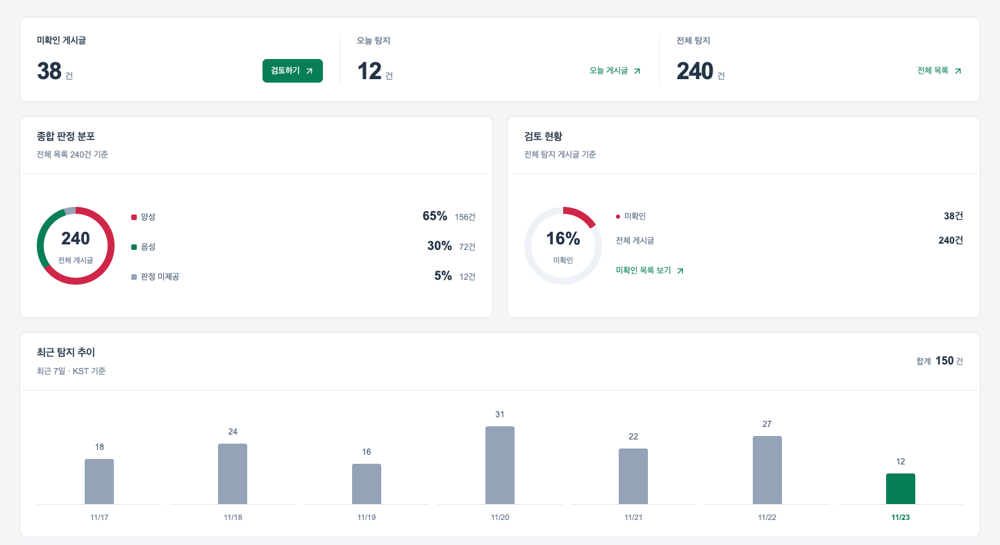
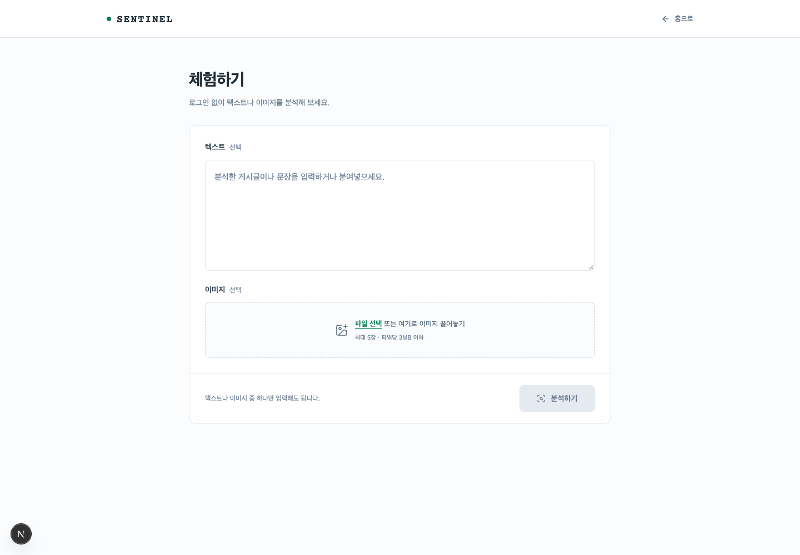

# SENTINEL

텍스트·이미지·OCR 분석 결과를 확인하고, 탐지 게시글을 검토하는 관리자 웹 콘솔입니다.

[](https://github.com/HelI-OKitty/drug-detection-frontend/actions/workflows/ci.yml)

[빠른 시작](#빠른-시작) · [화면과 기능](#화면과-기능) · [API 연동](#api-연동) · [검증과 배포](#검증과-배포)

## 화면과 기능



> 위 스크린샷은 실제 컴포넌트에 예시 데이터를 넣어 촬영했습니다. 운영 대시보드는 API 데이터를 사용합니다.

| 화면 | 주요 기능 |
| --- | --- |
| 대시보드 `/dashboard` | 전체·오늘·미확인 건수, 종합 판정 분포, 검토 현황, 최근 추이, 분석 통계 |
| 탐지 목록 `/detections` | 검색, 판정·검토·기간·OCR 유무 필터, 개별 양성 유형 OR 필터, 페이지 선택 |
| 탐지 상세 `/detections/[id]` | 게시글 원문, 텍스트·이미지·OCR 근거, 점수, 검토 확정, 삭제 확인 |
| 단순 분석 `/analyze` | 텍스트·이미지 입력, 결과 화면, 재시도, 새 분석, 이미지 점수순 정렬 |
| 공개 체험 `/try` | 로그인 없이 같은 분석 흐름 체험 |
| 크롤링 `/monitoring` | 수동 수집, 수집 기록, 자동 실행 설정 상태 |
| 설정 `/settings/detection`, `/settings/account` | 키워드·주기·수집 건수, 계정 정보, 별도 비밀번호 변경 화면 |

사이드바 접기와 고정 탐색을 지원합니다. 목록의 필터·페이지는 URL에 저장하며 상세에서 돌아올 때 이전 위치를 복원합니다.

<details>
<summary>텍스트·이미지 분석 화면 보기</summary>



텍스트 또는 이미지만 입력해도 분석할 수 있습니다. 이미지 업로드는 **파일당 3MB, 최대 5장**입니다.

</details>

## 빠른 시작

Node.js **22.18 이상인 22.x**와 npm을 사용합니다. 테스트는 Node의 TypeScript 직접 실행 기능을 사용합니다.

```bash
nvm use
npm ci
cp .env.example .env.local
npm run dev
```

개발 서버: [http://localhost:8080](http://localhost:8080)

`.env.local`을 환경에 맞게 설정합니다.

| 변수 | 용도 | 기본값 |
| --- | --- | --- |
| `BACKEND_API_URL` | 서버에서 사용하는 백엔드 주소 | 배포된 Cloud Run API |
| `INTERNAL_API_KEY` | 수동 크롤링의 `X-Internal-Key` 인증 | 없음. 수동 실행 시 필요 |
| `SIGNUP_ENABLED` | 회원가입 허용 여부 | `false` |

실제 키는 저장소에 올리지 않습니다. 내부 키에 `NEXT_PUBLIC_` 접두사를 붙이지 않습니다. 로그인·분석 기능에는 내부 크롤링 키가 필요하지 않습니다.

## API 연동

[현재 API 명세](https://drug-detection-671085027854.asia-northeast3.run.app/docs#/) · [OpenAPI JSON](https://drug-detection-671085027854.asia-northeast3.run.app/openapi.json) · [백엔드 저장소](https://github.com/HelI-OKitty/drug-detection-backend)

| 기능 | 백엔드 API |
| --- | --- |
| 인증 | `POST /auth/login`, `/auth/signup`, `/auth/refresh`, `/auth/logout` |
| 프로필·비밀번호 | `GET /profile`, `PATCH /profile` |
| 탐지 목록·상세 | `GET /detections`, `GET /detections/{id}` |
| 검토·삭제 | `PATCH /detections/{id}/status`, `DELETE /detections/{id}` |
| 대시보드 | `GET /dashboard/summary` 및 목록·상세 응답 집계 |
| 분석 | 브라우저 `POST /api/analyze` → 백엔드 `POST /public/analyze` |
| 크롤링 | `POST /crawl/trigger` |
| 크롤링 설정 | `GET/PATCH /crawl-settings`, `PATCH /crawl-settings/toggle` |

### 판정과 OCR 처리

- 종합 판정은 서버의 `is_drug`를 그대로 사용합니다. 검토 상태 변경은 AI 판정을 변경하지 않습니다.
- 개별 `prediction: null`은 **미제공**입니다. `source`를 보존하고, 알려진 사유는 설명으로 표시합니다. 점수로 양성·음성을 추정하지 않습니다.
- 목록의 `image_ai_results[].has_ocr_text`는 OCR 텍스트 존재 여부입니다. `false`면 `is_ocr_drug`와 무관하게 OCR 판정 집계에서 제외합니다.
- `image_ai_results[].is_ocr_drug`는 OCR 판정입니다. OCR 대상 중 하나라도 `true`면 양성, 모두 명시적으로 `false`면 음성, 판정이 누락되면 미제공입니다. OCR 대상이 없으면 **OCR 없음**으로 표시합니다.
- 상세·단순 분석의 OCR은 `ocr_text_results[]`에서 문구별 판정·점수·매칭 정보를 읽습니다.
- 양성 유형을 여러 개 선택하면 **OR**로 검색합니다. OCR 유무 필터와는 별개입니다.

[OCR 계약 상세](docs/ocr-verdict-contract.md)

### 실제 데이터와 예시 데이터

로그인 후 목록·상세·대시보드·설정은 실제 API를 사용하며, 조회 실패를 mock 데이터로 대체하지 않습니다. **비로그인 홈의 대시보드 미리보기와 README 대시보드 스크린샷만 예시 데이터**입니다. 자동 테스트의 응답 대역은 운영 화면에 포함되지 않습니다.

다음은 API 응답을 바탕으로 프론트에서 처리하는 부분입니다.

- 목록 검색·필터·페이지 이동: 조회한 전체 목록을 대상으로 처리합니다.
- 대시보드 분석 통계: 게시글별 상세 응답을 집계합니다. 게시글 수만큼 상세 요청이 추가되므로 규모가 커지면 전용 통계 API가 필요합니다.
- 크롤링 회차와 다음 실행 시각: 저장된 탐지 시각과 설정 주기로 **추정**합니다. 백엔드 실행 이력 자체는 아닙니다.
- 탐지 설정 조회 실패: 기본값과 실패 안내를 표시합니다.

### 인증과 실행 제한

액세스·리프레시 토큰은 서버에서 HttpOnly·SameSite=Lax 쿠키로 저장하며, 프로덕션에서는 Secure를 적용합니다. 미들웨어가 만료 임박 토큰을 갱신합니다.

회원가입은 기본적으로 비활성화됩니다. 다시 열려면 `SIGNUP_ENABLED=true`로 설정합니다. 백엔드의 가입 허용 정책도 함께 맞춰야 합니다.

수동 크롤링은 로그인한 관리자의 ID와 서버의 내부 키를 사용합니다. 크롤링 요청은 최대 270초 대기하며 `/monitoring`의 함수 실행 시간 설정은 300초입니다. 시간 초과 후에도 백엔드 수집이 이어질 수 있습니다.

이미지 5장을 전송할 수 있도록 프론트 요청 제한은 base64 인코딩을 고려한 21MiB입니다. 배포 플랫폼과 백엔드의 실제 요청 크기 제한도 별도로 충족해야 합니다.

## 개발 구조

```text
src/
├── app/                 # App Router 페이지, 서버 액션, 분석 프록시
├── components/          # 콘솔·목록·상세·분석 UI와 CSS Modules
├── lib/                 # API 요청, 응답 매핑, 필터, 공통 타입
└── middleware.ts        # 토큰 갱신
tests/                   # API 계약·필터·인증 테스트
docs/                    # OCR 계약 및 README 화면 이미지
```

Next.js 15 · React 19 · TypeScript 5 · CSS Modules / Tailwind CSS 4 · Lucide · ESLint 9

## 검증과 배포

| 명령 | 설명 |
| --- | --- |
| `npm run dev` | 개발 서버, 포트 8080 |
| `npm run lint` | ESLint 검사 |
| `npm test` | API 계약·필터·인증 회귀 테스트 |
| `npm run build` | 프로덕션 빌드 및 타입 검사 |
| `npm run start` | 프로덕션 서버, 기본 포트 3000 |
| `npm run verify` | 린트 → 테스트 → 프로덕션 빌드 |

```bash
npm run verify
```

테스트는 응답 대역을 사용하므로 실제 계정이나 내부 키 없이 실행하며, 운영 데이터를 변경하지 않습니다. 개발 산출물은 `.next-dev`, 프로덕션 빌드는 `.next`에 분리합니다.

- GitHub Actions는 `develop`·`release` 대상 PR과 해당 브랜치 push에서 검증합니다.
- Vercel은 `vercel.json`에 따라 `npm ci`와 `npm run verify`를 실행합니다.
- 배포 환경 변수와 Production 브랜치는 Vercel 프로젝트 설정에서 관리합니다. 로컬 `.env.local`은 배포 환경에 자동 전달되지 않습니다.
- PR 병합을 검증 결과에 연동하려면 브랜치 보호의 필수 검사로 `Lint, test and build`를 지정합니다.
